# Satflux Tickets 

## Event Ticketing and Management System using Bitcoin via BTCPay Server


### About this plugin

Satflux Tickets is a **standalone fork of
[Satoshi Tickets](https://github.com/TChukwuleta/BTCPayServerPlugins) by
TChukwuleta** - many thanks to the original author. The fork has its own
plugin identity (`BTCPayServer.Plugins.SatfluxTickets`), its own release
line and is maintained independently; upstream releases are never offered
as updates.

**What the fork adds on top of the original:**

- **Greenfield API** for external integrations: ticket purchase
  (`CreatePurchase`), offline/manual ticket issuance, event and ticket-type
  management, check-in - with API docs (`/api-docs`) and swagger.
- Events API returns **all event states** (`includeInactive`), not just
  active ones.
- **Ticket-type raffle bundles**: buying an admission can automatically
  grant raffle tickets via the companion BTCPay Raffle plugin (loose,
  reflection-based integration - neither plugin requires the other to be
  installed).
- **Resilient startup**: a database hiccup during boot can no longer get
  the plugin auto-disabled by BTCPay.
- Runs on **BTCPay Server 2.3.7+ / .NET 10**.
- **Legacy route compatibility**: previously issued ticket links and
  existing integrations using the original `satoshi-tickets` URL prefix
  keep working - `satflux-tickets` is the canonical prefix going forward.

### Introduction

The Satflux Tickets plugin enables users to sell tickets using Bitcoin payments via BTCPay Server. 

If you are an event organizer, conference host, or community managers, you can now create and manage events on your BTCPay Server instance that accept payments via Bitcoin using BTCPay Server. 

### Features

**Bitcoin Payments:** Accept Bitcoin payments securely via BTCPay Server.

**Event Creation & Management:** Organizers can create and manage events, ticket tiers, and pricing.

Automated QR Code Generation: Each ticket is linked to a unique QR code for seamless verification.

**Order & Transaction Management:** Track ticket purchases and payment confirmations.

**Decentralized and Self-Hosted:** Uses BTCPay Server, eliminating the need for third-party payment processors.

**Email Notifications:** Buyers receive confirmation emails with their QR-coded tickets.

Tickets addressed to the same mailbox within an order are delivered together in one
email, with a short ticket number, inline QR code and online link for each ticket.
Different recipients receive only their own tickets. Scheduled reminders include
all of a recipient's settled tickets for the current store and event; manually
resending a selected ticket sends that ticket only. QR codes retain the complete
check-in identifier, and a plain-text alternative includes every short number and link.

**Ticket Scanner:** For physical events, events managers can now scan events to grant entry to attendee


## Prerequisites:

Before diving into the setup process, ensure you have the following:

- BTCPay Server - [self-hosted](Deployment.md) or run by a [third-party host](/Deployment/ThirdPartyHosting.md) v2.0.0 or later.
- [Created BTCPay Server store](CreateStore.md) with [wallet set up](WalletSetup.md).
- Configured Email in Store settings (for sending email notifications).


## Usage Guide

### Installation and configuration

1. Go to your BTCPay Server >> Manage plugins. Find and install "Satflux Tickets" plugin.

2. Once installed, navigate to the plugin page and click on the "Satflux Tickets" plugin.

3. First thing is to make sure you have set the Email/SMTP for your store, if not you will see a notification at the top. Follow the link which will bring you to your store Settings >> Email Settings. Fill in the necessary details and save.

### Create an event

1. Click on 'Create Event' button to create a new event. Fill necessary details about the event including the email content that would be sent on purchase. You can upload a logo or image for the event.
   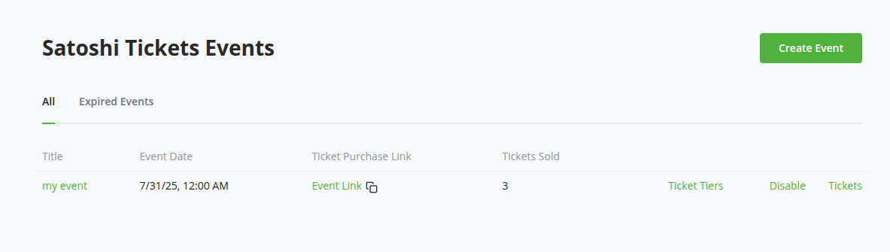
   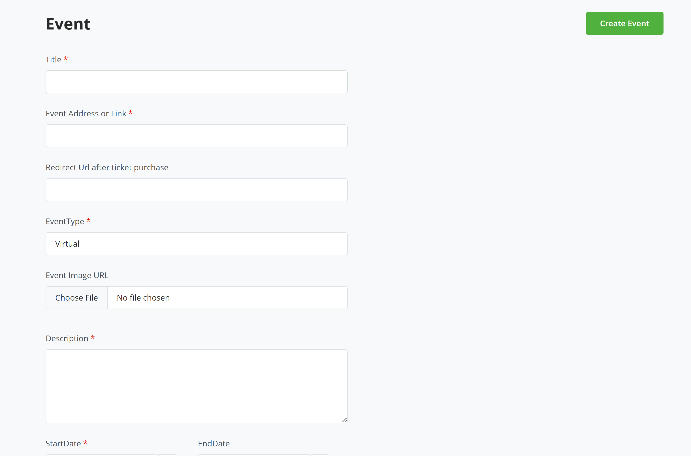

2. Once created successfully, you'd be redirected to a page where you would need to configure ticket tiers which would include tier name, ticket price, quantity (number of available tickets for this ticket tier).
   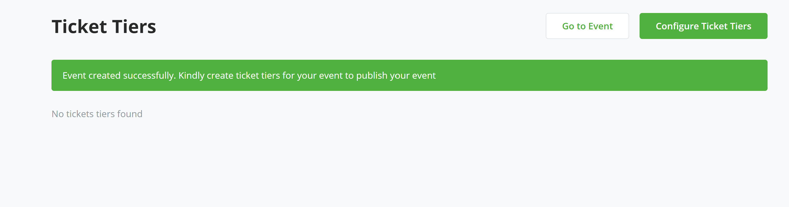   
   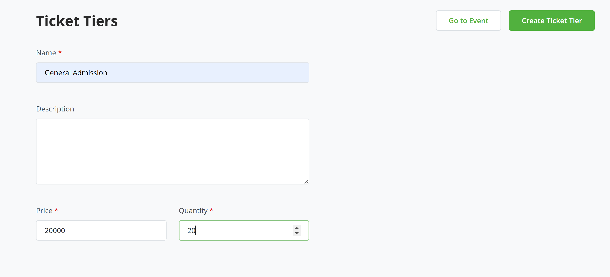

3. You can configure as many ticket tiers/levels as you want.
   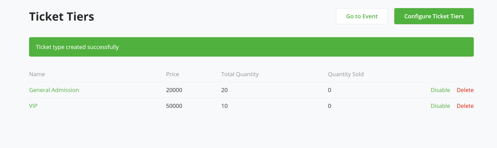

4. Navigate to the events list page. Activate the event. (Otherwise the event link will return a 404 error)
   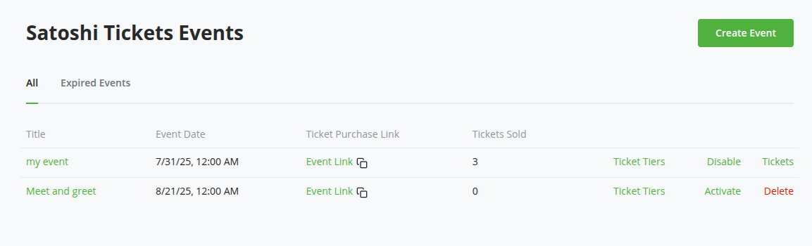

6. You can now share the event link (see column "Ticket Purchase link") with your audience, or put it up in websites, newsletters, chats or anywhere else.


### Purchasing tickets
1. On the ticket page, users can see the event information. 
   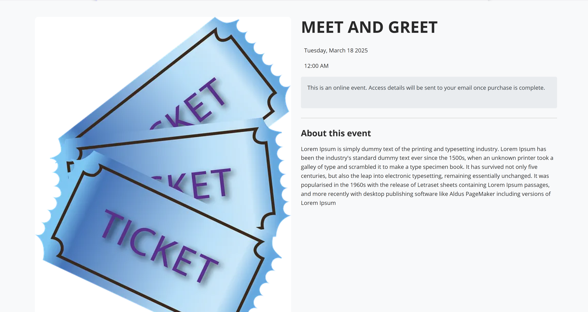
   

2. After clicking on "Get a Ticket", the user can choose between the configured ticket tiers and enter the desired quantity. The summary will show the total payment amount.
   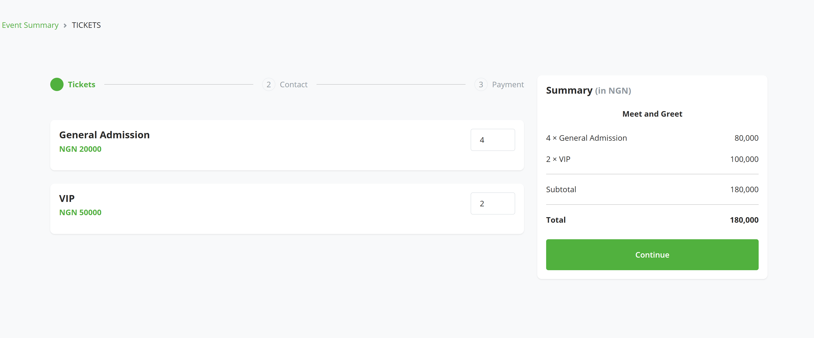
3. After clicking on "Continue", the user is then requested to enter their name and email. This allows users to receive tickets via email and also to track their ticket purchase.
   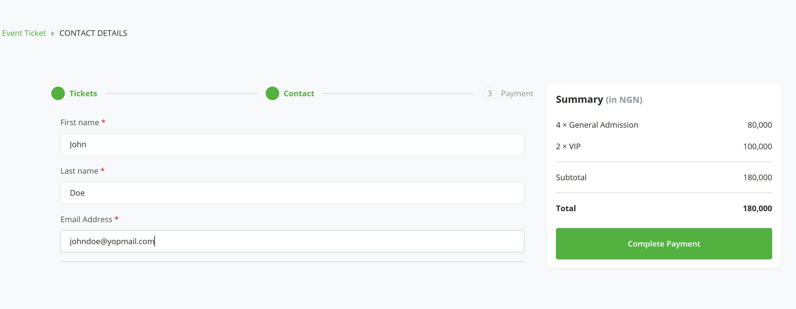
4. After clicking on "Complete payment" the BTCPay checkout page will be shown. The user can choose between the available payment methods (on-chain, Lightning, etc.) and pay the ticket price.
   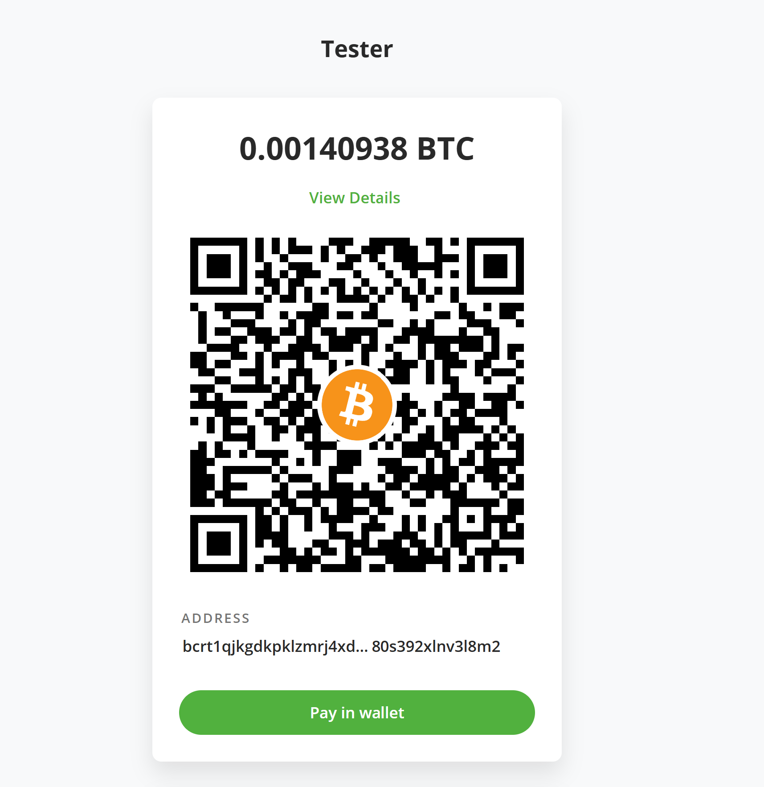
5. After the payment is confirmed, the user will see the confirmation page and can print a receipt. At the same time the email notification with the link to the tickets will be sent to the user. 
   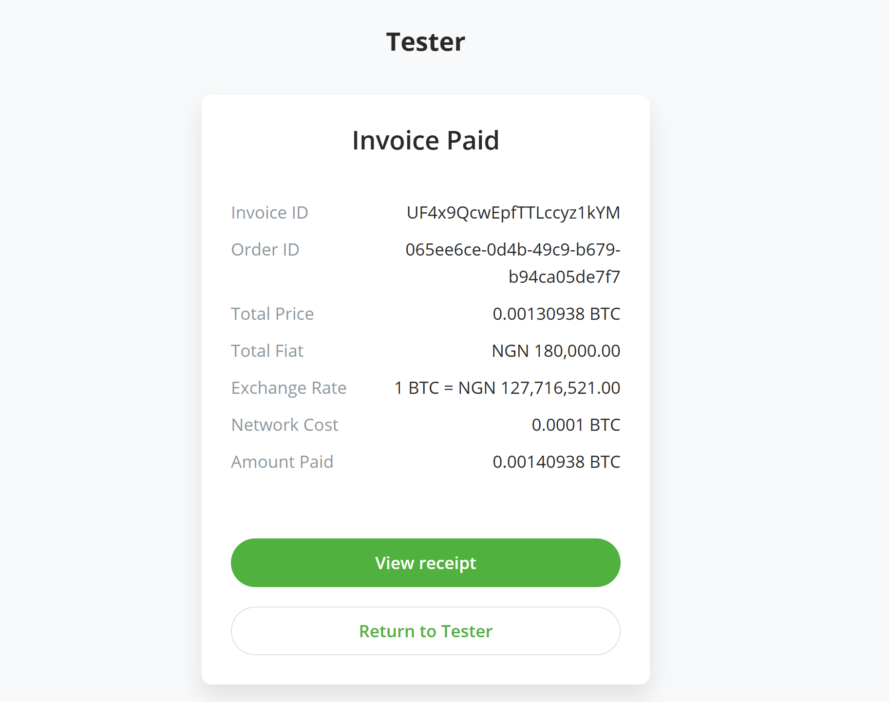

Congratulations, everything is set up and ticket purchasing is working.

### Checking-in and validating tickets
1. After the user has paid, they will receive an email with a link to download their ticket. The ticket contains a QR code that can be scanned at the event entrance.
   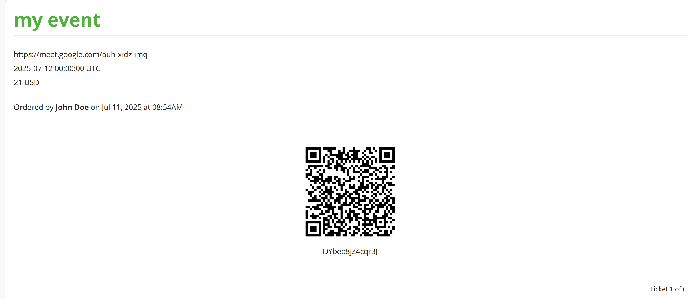

2. The event organizer can use the admin panel check in event attendees by clicking on "tickets" in the event overview.
   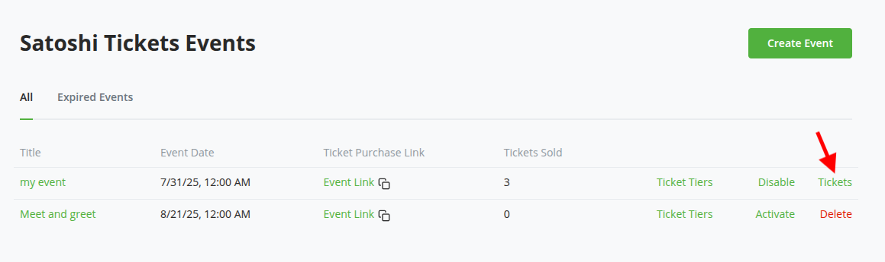   

3. In the ticket list, tickets can be searched by the ticket ID, name or email. By clicking on "Check-in"
   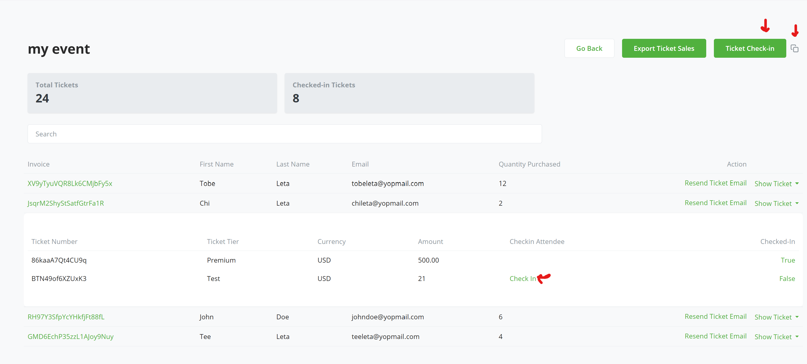   

   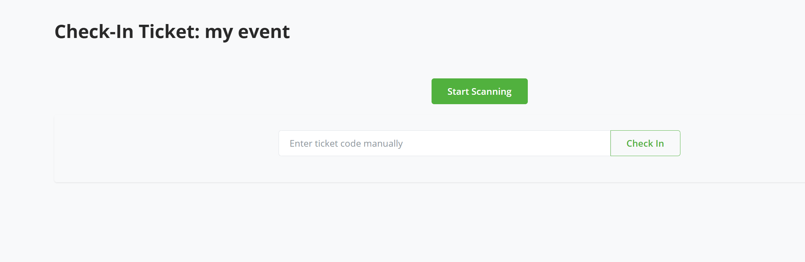   

   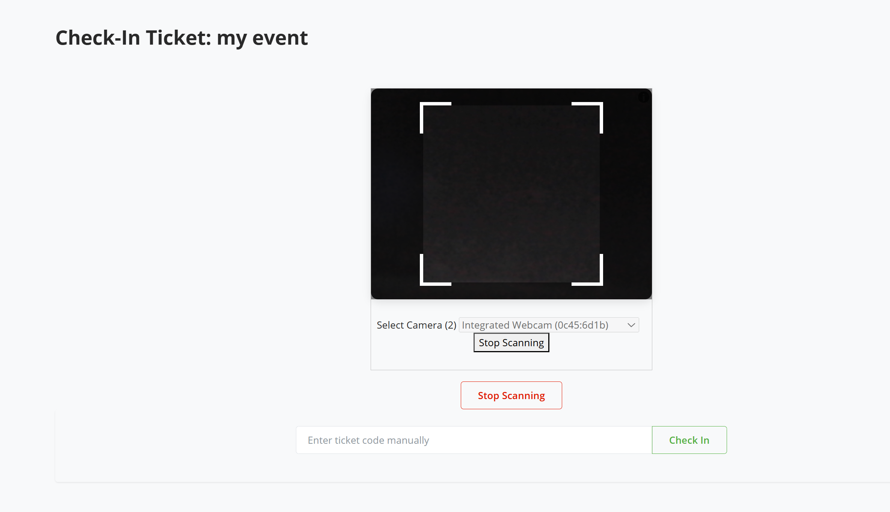   


## API Documentation

Satoshi tickets plugin API now available. See documentation at:

```
{btcpay_server_url}/plugins/{storeId}/satflux-tickets/api-docs

```

All endpoints require a BTCPay Server Greenfield API key passed in the `Authorization` header.

```
Authorization: token YOUR_API_KEY
```

**Required permissions:**

- `btcpay.store.canviewstoresettings` - for all GET (read) endpoints
- `btcpay.store.canmodifystoresettings` - for all POST, PUT, DELETE (write) endpoints

To create an API key: BTCPay Server > Account > Manage Account > API Keys > Generate Key. Select at minimum the permissions `CanViewStoreSettings` and `CanModifyStoreSettings` for the target store.


## Contribute

This BTCPay Server plugin is built and maintained entirely by contributors around the internet. We welcome and appreciate new contributions.

Do you notice any errors or bug? are you having issues with using the plugin? would you like to request a feature? or are you generally looking to support the project and plugin please [create an issue](https://github.com/TChukwuleta/BTCPayServerPlugins/issues/new)

Feel free to join our support channel over at [https://chat.btcpayserver.org/](https://chat.btcpayserver.org/) or [https://t.me/btcpayserver](https://t.me/btcpayserver) if you need help or have any further questions.


## Unified sales and ticket-type ordering (2.1.0 candidate)

The public event overview, ticket selection and attendee details share one page on the BTCPay host. Existing public URLs remain valid and payment still opens hosted BTCPay checkout. The layout uses saved event fields and supports physical and virtual events without event-specific hardcoded copy. Sales labels support EN/SK/ES/DE/CS. From 2.1.1, language follows a supported explicit `lang` query/form choice or weighted browser preferences, independently of host invariant culture. From 2.1.2, the header selector updates trusted public copy immediately in the existing DOM without requests or reload; it preserves quantities, recipient inputs, incomplete drafts and checkout nonce. The selected form language and shareable URL stay synchronized. The bounded CSRF-protected presentation action remains a compatibility fallback. Sales JS/CSS use validated content-hash paths and explicit revalidation, while legacy asset URLs remain available without storage caching. This prevents the reproduced stale-2.1.0-script combination from silently retaining UTC or the old language-button behavior; the actual origin of an operator cache still requires browser/network evidence. Event dates remain UTC instants in storage. From 2.2.0, physical events use explicit venue time and virtual events use labelled visitor time, with a clear UTC fallback. See the venue-time section below; no zone is inferred from location text. Hosted BTCPay checkout language remains independently controlled.

In the existing ticket-type management list, edit the order with drag/drop or labelled up/down buttons, then save or cancel. The authoritative persisted order is also used by the public offer and compatible Satflux clients. New types append; disabled types remain in the management sequence but are filtered publicly. Ordering does not change prices, capacities, defaults or issued tickets.

The `GET`/`PUT events/{eventId}/ticket-types/order` contract returns `{ticketTypeIds,revision}`; PUT accepts `{ticketTypeIds,expectedRevision}`. Send all event types, including disabled ones. Stale membership or revision returns 409. Explicit legacy name/price sorting remains supported. The migration adds ordering fields and backfills by name then ID; it does not infer historical creation order.

Install the compatible plugin before enabling the Satflux consumer's ordering controls. This candidate remains subject to review and release approval. Preserve database backups and use additive-schema-compatible rollback; do not remove ordering columns during active sales.

### Venue time zones (2.2.0)

Physical events show the local time at the venue with the event-specific UTC offset
and IANA zone, independent of a visitor's browser or VPN. Virtual events retain
visitor-local public formatting with an explicit UTC fallback. Choose the venue
zone in the existing event editor; dates remain stored as UTC instants.

The additive 2.2.0 migration backfills existing physical events to
`Europe/Bratislava`, as confirmed by this deployment's Product Owner. It changes
metadata only. Virtual events and stored timestamps/reminders remain unchanged.
New legacy API creates without a zone are not assigned an inferred venue; their
public schedule clearly shows UTC until an administrator assigns one.

Authenticated store-scoped `GET .../satflux-tickets/time-zones` returns the
provider-authoritative IANA catalog. Create/update accept `timeZone`, `startLocal`
and nullable `endLocal` civil fields, or the existing explicit UTC/offset instant
fields. Do not send both representations for the same date. Partial updates preserve
omitted dates and their exact precision; omitted/null zone preserves metadata, while
`endLocal:null` clears the end. Edited non-existent or ambiguous DST hours are rejected
rather than assigned an arbitrary offset. Explicit instant API clients remain compatible.

This candidate is built against the pinned BTCPay 2.4.5 / .NET 10 host. Install it
before the dependent Satflux event-form changes. Retain additive schema on rollback;
do not drop metadata or rewrite UTC dates. Normal database backups and the earlier
checkout reconciliation/worker compatibility constraints still apply. No new environment
variable, server timezone change, core modification or third-party plugin change is needed.

Satflux preselects its own locally saved store zone for new physical events; a per-event override is preserved independently. The pinned BTCPay Store API does not persist that Satflux setting, so native BTCPay creation requires an explicit venue selection. Native edits carry original UTC schedule hints and reject detected stale start/end values before saving, retaining the draft for review and reload. This is not full event-metadata compare-and-swap.
